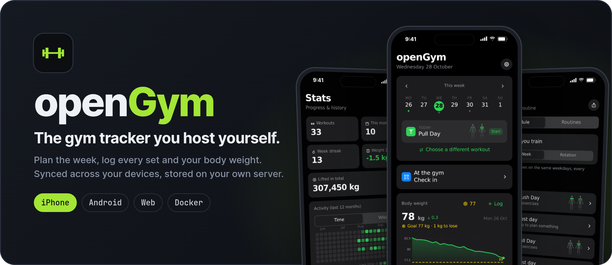

<div align="center">

<p>
<picture>
  <source media="(prefers-color-scheme: dark)" srcset="assets/readme/hero-dark.png">
  <source media="(prefers-color-scheme: light)" srcset="assets/readme/hero-light.png">
  
</picture>
</p>

<a href="LICENSE"></a>
<a href="https://github.com/zhiqiuyan/openGym/releases/latest"></a>

**[下载最新 HAP 安装包](https://github.com/zhiqiuyan/openGym/releases/latest)** · [全部版本](https://github.com/zhiqiuyan/openGym/releases) · [上游项目](https://github.com/DuarteSantos8/openGym) · [同步规则](docs/UPSTREAM-SYNC.md)

</div>

# openGym 鸿蒙版（HarmonyOS edition）

> 开源的健身与自重训练记录工具：规划训练计划、记录每次训练、查看各肌群的训练覆盖，并可从 Strong、Hevy、FitNotes 导入历史数据。数据可以自己托管，也可以只留在手机里独立使用。
>
> 上游 [DuarteSantos8/openGym](https://github.com/DuarteSantos8/openGym) 提供 iPhone／Apple Watch 应用、Android APK、Web 与 Docker 自托管；**本仓库是它的公开 fork，另维护一条独立的 HarmonyOS 版本线**，以 HAP 安装包发布。

本页描述的是这个仓库实际提供的内容。软件本身的完整功能列表请阅读[上游 README](https://github.com/DuarteSantos8/openGym#features)。

## 这个仓库是什么

| 项目 | 实际情况 |
| --- | --- |
| 上游 | [DuarteSantos8/openGym](https://github.com/DuarteSantos8/openGym)，作者 Duarte Santos |
| 仓库性质 | 公开 fork；与上游作者及 Gym visual 无隶属或背书关系 |
| 默认分支 | `harmony`（发版分支 = 上游主线 + 鸿蒙版补丁集） |
| `main` | 上游 `main` 的**纯镜像**，逐提交快进，内容与上游一致 |
| 当前鸿蒙版 | `1.0.2`（2026-11-06），独立的产品线与版本序列，自 `1.0.0` 起 |
| 许可证 | GNU AGPL v3.0；动作媒体另有单独授权限制（见[版权与许可](#版权与许可)） |

## 下载与安装

| 平台 | 获取方式 | 维护方 |
| --- | --- | --- |
| **HarmonyOS** | 本仓库 [最新 Release](https://github.com/zhiqiuyan/openGym/releases/latest) 的 HAP | 本 fork |
| iPhone / iPad / Apple Watch | 上游的 [App Store](https://apps.apple.com/app/id6822275400) | 上游 |
| Android | 上游 [Release 中的签名 APK](https://github.com/DuarteSantos8/openGym/releases/latest) | 上游 |
| Web / 自托管 | 上游的 Docker Compose 部署 | 上游 |

**当前版本 `1.0.2`**

- `versionName 1.0.2` · `versionCode 10002` · `buildVersion 3`
- 文件 `openGym-Harmony-1.0.2-20261106-unsigned.hap`，233,878,589 字节（含内置动作媒体）
- SHA256 `c168ae358e172679f236a7a3ff05f39af44f81e5791510406abc5e8fd0cf24f3`
- 同批附件：`.sha256` 单文件校验与 `SHA256SUMS` 汇总校验

下载后建议先校验完整性：

```bash
sha256sum -c SHA256SUMS
```

```powershell
(Get-FileHash .\openGym-Harmony-1.0.2-20261106-unsigned.hap -Algorithm SHA256).Hash
```

安装包文件名以 `-unsigned` 结尾，部署到真机前需按 HarmonyOS 平台要求完成签名（本仓库不提供签名证书）。
每版 `versionCode` 严格递增，可直接覆盖安装旧版；应用内「关于与更新 → 检查更新」指向本仓库的
`/releases/latest`，与 Android APK 的自更新渠道相互独立。

## 鸿蒙版相对上游的改动

- **中文数据**：简体动作名称、指导与描述全量翻译；繁体包用项目内 OpenCC 词表补齐为全量 5,632 条，消除残留的英文步骤。平台无关的数据文件已单独提取，向上游提交了 [PR #1008](https://github.com/DuarteSantos8/openGym/pull/1008)。
- **AI 教练**：新增 DeepSeek 提供商与自定义模型（模型名可自由输入），并保留 OpenAI 兼容端点；修复 HarmonyOS `SecureStorage` 桥接层的参数契约，API key 可以正常持久化。
- **版本与更新**：独立版本线、独立更新渠道与检查更新入口。
- **关于与更新页**：重做品牌区、版本与许可证入口，保留「免费，没有广告、没有订阅、没有追踪」，移除捐赠与评分区块，补充版权、许可证、源码与第三方声明链接。
- **界面适配**：适配上游新增的系统栏模块与 1.4.5 设计令牌。
- **语言包一致性**：当前 19 个界面语言包键集合一致（各 3,619 键）。

## 版本与发版

- 独立版本序列（semver），与上游 `1.4.x` 不共享版本号，但共享迭代节奏：每次上游同步或自有修复 → `patch`；成片新功能 → `minor`；不兼容改动 → `major`。
- 版本唯一来源是鸿蒙原生工程的 `AppScope/app.json5`（`versionName` / `versionCode` / `buildVersion`）；前端构建读取它注入 `__APP_VERSION__`，保证界面版本与安装包版本一致。
- 每个版本号对应**唯一不可变的 HAP + 独立 Release**（`harmony-vX.Y.Z`），不覆盖已发布附件；`versionCode` 每版固定 +1。
- 版本变更记录在鸿蒙工程的 `CHANGELOG.md`。**注意**：`opengym-harmony/` 原生工程（ArkTS 壳、应用清单、打包脚本、CHANGELOG）目前**不在本仓库内**，本仓库只托管前端源码；HAP 仅以 Release 附件形式提供。

## 与上游保持同步

- `main` 是上游 `main` 的纯镜像；`harmony` 以 **merge commit** 合入上游（不能 squash、不能 rebase），只有保留上游提交作为祖先，GitHub 才会显示「0 commits behind」。
- 2026-11-06 完成首次全量同步：一次性合入上游 305 个提交至 `8fb98b16`（v1.4.4 线），并按补丁集清单逐项重贴鸿蒙版增量。当前 `main` 与上游一致，`harmony` 相对上游为 **0 behind**。
- 每日自动同步工作流的全文保存在 [`docs/sync-upstream.yml.example`](docs/sync-upstream.yml.example)，**当前尚未启用**：用于发布的 CLI token 缺少 `workflow` scope，GitHub 会拒绝写入 `.github/workflows/`。启用只需在网页把该示例文件的路径改为 `.github/workflows/sync-upstream.yml` 后提交，内容无需改动。
- 分支职责、手动同步流程、版本规则、冲突补丁集清单与同步台账见 [docs/UPSTREAM-SYNC.md](docs/UPSTREAM-SYNC.md)。

## 自行构建

前端部分可以只凭本仓库复现：

```bash
git clone https://github.com/zhiqiuyan/openGym.git
cd openGym/frontend
npm ci
VITE_MOBILE=1 VITE_HARMONY=1 npm run build
```

`VITE_HARMONY=1` 时，Vite 会把 `@capacitor/*` 别名到 `frontend/src/lib/harmony/*` 桥接层，并从鸿蒙清单读取版本号。校验命令：`node scripts/check-locales.mjs`（语言包键集合）、`npx vitest run`（前端测试）。

**HAP 打包无法仅凭本仓库源码复现**：还需要鸿蒙原生工程与 DevEco Studio / hvigor，而该工程目前未随仓库发布。其流程是把前端 `dist` 与动作媒体同步进 `entry/src/main/resources/rawfile` 后打包，且包内 `module.json` 与 `pack.info` 的版本字段必须与 `app.json5` 一致。请直接使用 Release 附件。

> [!NOTE]
> 在 Windows 本地运行完整测试时，仍有若干与路径分隔符、CRLF、临时目录绝对路径、生成图标时间戳相关的用例失败；这些属于环境差异，建议在 Linux / CI 环境复核。

## 上游功能概览

以下能力来自上游项目，本 fork 予以保留：5,632 个动作及动画演示、按周或轮转的训练计划、训练中的组间计时与 PR 检测、渐进超负荷规则、1RM 与肌群训练量地图、体重曲线与进度照片、从 FitNotes / Strong / Hevy / Apple Health 导入、JSON 与 CSV 导出、Passkey 登录与多设备同步、可开关的功能模块与可选 AI 教练等。

完整逐项的功能、架构、自托管配置与路线图见 [上游 README](https://github.com/DuarteSantos8/openGym#features) 与 [文档索引](docs/README.md)。本仓库不复制上游的路线图与发布计划，也不维护其 Discord、应用商店渠道或捐赠入口。

## 版权与许可

- 原项目 openGym — Copyright (C) 2026 Duarte Santos，代码以 **GNU AGPL v3.0** 授权（[LICENSE](LICENSE)）。本 fork 的修改作为同一 AGPL 作品提供，不对上游代码、openGym 名称与商标或动作媒体主张版权。
- 第三方声明（应用商店例外条款、MuscleMap MIT 声明、动作媒体署名与限制）见 [NOTICE.md](NOTICE.md)；本 fork 的署名范围与改动说明见 [COPYRIGHT.md](COPYRIGHT.md)。
- **动作媒体不受 AGPL 覆盖**：静帧与动画 © Aliaksandr Makatserchyk / [Gym visual](https://gymvisual.com/)，仅授权在 openGym 内使用。本仓库为非商业 fork，媒体保持未修改并随附声明；HAP 内包含这些媒体，不得从中提取后另作他用。商业使用或单独再分发媒体须自行取得授权。
- 本 fork 与 Duarte Santos、Gym visual 无隶属或背书关系。

## 反馈

- 鸿蒙版安装包、中文数据、AI 教练相关问题 → 本仓库 [Issues](https://github.com/zhiqiuyan/openGym/issues)。
- 上游功能缺陷、自托管、iOS / Android 应用相关问题 → [上游 Issues](https://github.com/DuarteSantos8/openGym/issues)。
- 本 fork 不设捐赠或赞助入口；如需支持原作者，请前往上游项目。
